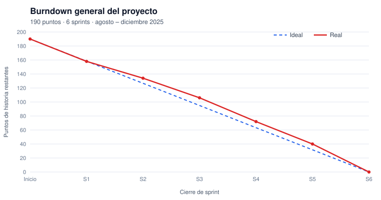
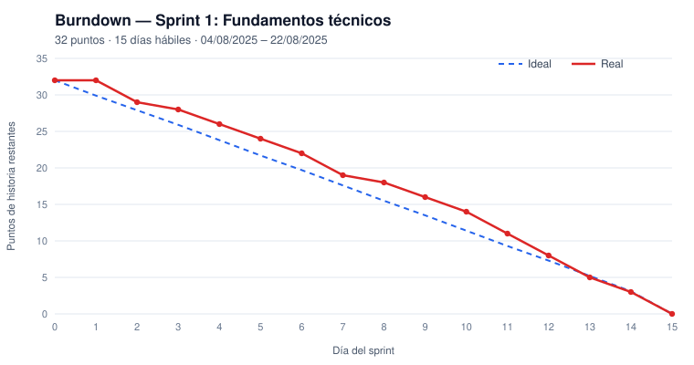
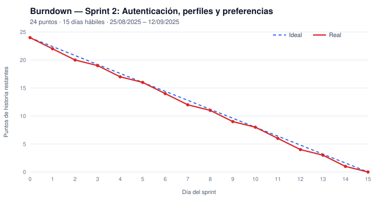
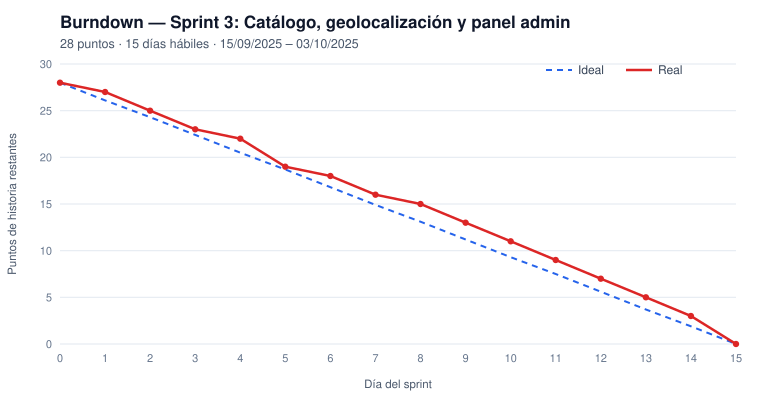
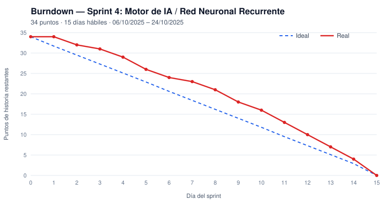
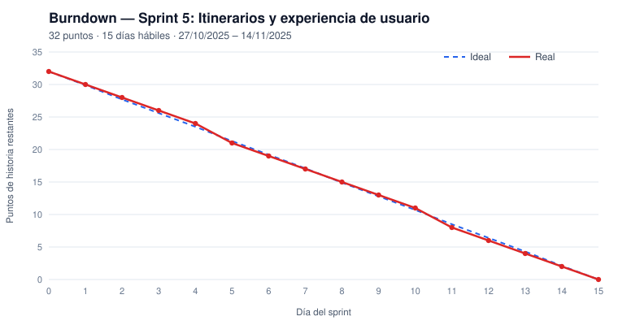
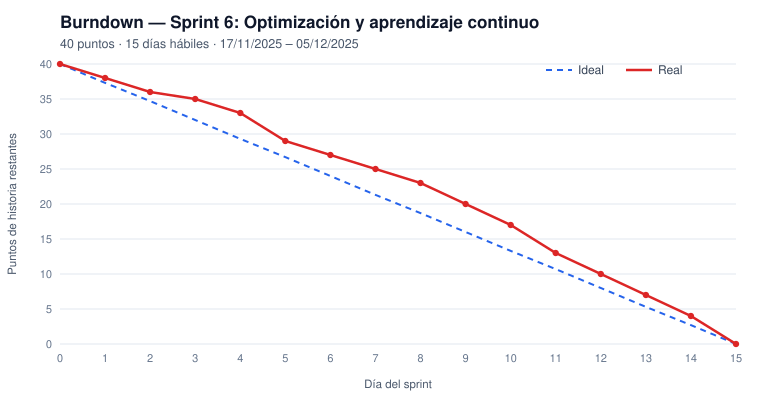

# Etreva Travel — Sistema web de recomendaciones turísticas con RNN

Sistema web de recomendaciones personalizadas de atractivos turísticos de La Paz (Bolivia) para la agencia **Etreva Travel**. Usa una red neuronal recurrente implementada con **Brain.js** y es el proyecto de grado de Kevin Ronny Carrillo Muñoz.

**Tecnologías:** PHP (MVC propio) · PostgreSQL · JavaScript · Brain.js · Bootstrap · Chart.js · TCPDF

## Metodología: XP + Kanban

El desarrollo siguió una metodología ágil **híbrida**:

- **XP** aporta la ingeniería y las iteraciones: historias de usuario, estimación en puntos, iteraciones de 3 semanas, diseño simple, pruebas, refactorización e integración continua.
- **Kanban** gestiona visualmente el flujo de cada fase: tablero Por hacer → En progreso → En pruebas → Terminado, con límite WIP.

A las iteraciones de XP se les llama "sprints" solo como sinónimo. La justificación completa, con referencias y el texto sugerido para el documento, está en [docs/metodologia/METODOLOGIA.md](docs/metodologia/METODOLOGIA.md).

| Artefacto | Dónde está |
|---|---|
| Backlog (52 requerimientos, 190 puntos) | [Issues](../../issues?q=is%3Aissue) · [docs/backlog.csv](docs/backlog.csv) |
| Iteraciones | [Milestones](../../milestones?state=closed) Sprint 1 … 6 |
| Tablero Kanban | [Tablero Kanban Etreva](https://github.com/users/k3vinfx/projects/6): vista general y una vista por sprint |
| Burndown | [docs/burndown](docs/burndown) |

### Puntos de historia por iteración

Los puntos se calculan con la complejidad del backlog: **Baja = 1, Media = 3, Alta = 5**.

| Iteración | Alcance | Req. | Puntos | Fechas |
|---|---|---|---|---|
| Sprint 1 | Fundamentos técnicos | 10 | 32 | 04/08 – 22/08/2025 |
| Sprint 2 | Autenticación, perfiles y preferencias | 8 | 24 | 25/08 – 12/09/2025 |
| Sprint 3 | Catálogo, geolocalización y panel admin | 8 | 28 | 15/09 – 03/10/2025 |
| Sprint 4 | Motor de IA / Red Neuronal Recurrente | 8 | 34 | 06/10 – 24/10/2025 |
| Sprint 5 | Itinerarios y experiencia de usuario | 8 | 32 | 27/10 – 14/11/2025 |
| Sprint 6 | Optimización y aprendizaje continuo | 10 | 40 | 17/11 – 05/12/2025 |
| **Total** | | **52** | **190** | |

### Burndown general



### Burndown por iteración

| | |
|---|---|
|  |  |
|  |  |
|  |  |

## Instalación local (Laragon)

1. Clonar el repositorio en `C:\laragon\www\etreva`.
2. Instalar las dependencias: `composer install` y `npm install`.
3. Crear la base de datos `etreva_travel` en PostgreSQL y cargar el esquema: `psql -U postgres -d etreva_travel -f database/etreva_schema.sql`.
4. Copiar `config/mail.example.php` a `config/mail.php` y completar los datos SMTP.
5. Abrir `http://localhost/etreva`.

## Estructura

```
controller/   controladores (index.php?c=…&a=…)
model/        acceso a datos y lógica (PDO pgsql)
view/         vistas del turista (cliente/) y del administrador (admin/)
assets/       css, js, imágenes, TCPDF
lang/         traducciones es / en / pt / fr / de
database/     esquema de la base de datos
docs/         metodología, backlog y burndown
herramientas/ scripts CLI (datos de prueba, traducciones, fotos)
swagger/      documentación de la API
```
