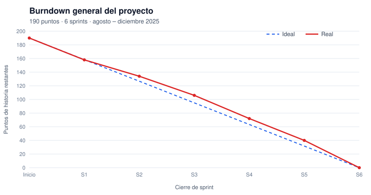

# Metodología de desarrollo: XP + Kanban (híbrida)

Este documento respalda el capítulo **2.4 Metodología de desarrollo de software** y la sección **3.5.1 Planificación de desarrollo** del proyecto de grado. Explica por qué en el documento aparecen *sprints*, tableros Kanban y gráficos *burndown* aunque la metodología declarada es **XP**.

## 1. Respuesta corta (para la defensa)

> El proyecto no usa Scrum. Usa **XP como metodología de ingeniería** (historias de usuario, juego de la planificación, iteraciones cortas, diseño simple, pruebas, refactorización e integración continua) y **Kanban como método de gestión visual del flujo** dentro de cada fase. A las iteraciones de XP las llamamos "sprints" solo como sinónimo coloquial. El *burndown* es una herramienta de seguimiento del avance de una iteración que XP ya contempla: la velocidad, el *tracking* de la iteración y los gráficos visibles del espacio de trabajo informativo. No es un artefacto exclusivo de Scrum. Es la misma idea de **Scrumban** (Ladas, 2009), solo que con XP como base técnica en lugar de Scrum.

## 2. De dónde viene cada elemento

| Elemento usado en el proyecto | Origen metodológico | Cómo se aplicó | Sección del documento |
|---|---|---|---|
| Historias de usuario | XP: juego de la planificación (Beck, 2000) | 52 requerimientos (RF, RNF, RT) redactados como historias | 3.7, 3.8 |
| Estimación en puntos | XP: estimación de historias y velocidad (Beck y Fowler, 2000) | Baja = 1, Media = 3, Alta = 5 puntos; 190 puntos en total | 3.9 (columna Complejidad), 4.4 |
| Iteraciones de 3 semanas ("sprints") | XP: iteraciones de 1 a 3 semanas (Beck, 2000) | 6 iteraciones de 15 días hábiles | 3.10.4, 4.4 |
| Plan de entregas por fases | XP: planificación de entregas (Beck y Fowler, 2000) | Fase 1 a Fase 6, cada una con un incremento funcional | Tabla 3.67 |
| Diseño simple, pruebas, refactorización | XP: prácticas de ingeniería | Arquitectura MVC simple, pruebas por iteración, refactorización de la RNR | 2.4.1, 3.5.2 |
| Integración continua | XP | Cada historia se integra al repositorio y cierra su tarjeta | Repositorio (commits que cierran issues) |
| Tablero con columnas Por hacer → En progreso → En pruebas → Terminado | Kanban: visualizar el flujo (Anderson, 2010) | Un tablero por fase con tarjetas por requerimiento | 2.4.2, 3.11.7 … 3.16.2 |
| Límite de trabajo en progreso (WIP) | Kanban (Anderson, 2010) | Máximo 2 tarjetas "En progreso" y 3 "En pruebas" (desarrollo individual) | 2.4.2 |
| Burndown por iteración y general | Seguimiento de la iteración en XP: *tracking* y gráficos visibles (Beck y Fowler, 2000; Beck y Andres, 2004) | Puntos restantes por día y por cierre de iteración | 4.4 |

## 3. Qué NO se tomó de Scrum

- No hay Scrum Master.
- No hay *Daily Scrum*, *Sprint Review* ni *Sprint Retrospective* como ceremonias formales. Solo hay puntos de control con el cliente al final de cada iteración, como en XP.
- No hay *Product Owner* como rol de Scrum: el representante de Etreva Travel actúa como **cliente en sitio** de XP, que prioriza las historias.
- Las iteraciones no se blindan contra cambios: como en Kanban, una tarjeta puede repriorizarse si el cliente lo pide.

Por eso la metodología se denomina **híbrida XP + Kanban**, y no Scrum ni XP + Scrum.

## 4. Cómo funcionó el ciclo en cada fase

1. **Planificación de la iteración (XP).** Al iniciar la fase se toman del backlog los requerimientos de esa fase (Tabla 3.67) y se suman sus puntos. Es el compromiso de la iteración.
2. **Tablero Kanban de la fase.** Cada requerimiento es una tarjeta que recorre Por hacer → En progreso → En pruebas → Terminado, respetando el límite WIP.
3. **Ingeniería XP sobre cada tarjeta.** Diseño simple → codificación → pruebas → refactorización → integración al repositorio.
4. **Seguimiento.** Cada día se registran los puntos de las tarjetas que llegaron a *Terminado*; con eso se dibuja el burndown de la iteración.
5. **Cierre.** Se entrega un incremento funcional al cliente, se valida y se actualiza el burndown general.

## 5. Datos que respaldan el burndown

Las sumas de puntos salen directamente del backlog (Tabla 3.64), con Baja = 1, Media = 3 y Alta = 5:

| Iteración | Requerimientos | Puntos | Fechas (15 días hábiles) |
|---|---|---|---|
| Sprint 1 — Fundamentos técnicos | RT1, RT4, RT3, RT6, RF23, RNF4, RNF5, RNF3, RNF1, RNF8 | 32 | 04/08/2025 – 22/08/2025 |
| Sprint 2 — Autenticación, perfiles y preferencias | RF1, RF2, RF3, RF4, RF26, RF5, RF6, RF27 | 24 | 25/08/2025 – 12/09/2025 |
| Sprint 3 — Catálogo, geolocalización y panel admin | RT8, RT9, RF25, RF31, RF29, RF10, RF24, RNF13 | 28 | 15/09/2025 – 03/10/2025 |
| Sprint 4 — Motor de IA / RNR | RT2, RT7, RF7, RF21, RF9, RF20, RF8, RNF6 | 34 | 06/10/2025 – 24/10/2025 |
| Sprint 5 — Itinerarios y experiencia de usuario | RF11, RF12, RF14, RF15, RF16, RF19, RF28, RNF11 | 32 | 27/10/2025 – 14/11/2025 |
| Sprint 6 — Optimización y aprendizaje continuo | RF18, RF22, RF17, RF30, RNF2, RNF10, RNF14, RNF9, RNF12, RNF15 | 40 | 17/11/2025 – 05/12/2025 |
| **Total** | **52** | **190** | |

- Datos diarios: [`docs/burndown/burndown.csv`](../burndown/burndown.csv), los mismos de las Tablas 4.11 a 4.16.
- Backlog con puntos: [`docs/backlog.csv`](../backlog.csv).

## 6. Texto sugerido para corregir el documento

**En el Resumen y en el Abstract**, reemplazar "se implementó la metodología de desarrollo ágil XP" por:

> …se implementó una metodología ágil híbrida que combina **Programación Extrema (XP)**, para las prácticas de ingeniería y la planificación por iteraciones, con **Kanban**, para la gestión visual del flujo de trabajo en cada fase…

**En 2.4, al final de 2.4.2**, agregar el subtítulo *2.4.3 Integración XP + Kanban*:

> La combinación de un método iterativo con un tablero Kanban tiene antecedentes en la literatura ágil. Ladas (2009) describe *Scrumban*, que conserva las iteraciones con tiempo fijo y gestiona el trabajo con un tablero Kanban y límites WIP. Kniberg y Skarin (2010) muestran que estos métodos son herramientas de proceso que se pueden combinar según el contexto. En el presente proyecto se aplica el mismo principio, pero con XP como base: las iteraciones, las historias de usuario estimadas en puntos, el diseño simple, las pruebas, la refactorización y la integración continua provienen de XP (Beck, 2000; Beck y Fowler, 2000), mientras que la visualización del flujo, los límites de trabajo en progreso y la mejora continua del flujo provienen de Kanban (Anderson, 2010). En este documento el término *sprint* se usa como sinónimo de **iteración XP** y no implica la adopción del marco Scrum. El *burndown chart* se emplea como herramienta de seguimiento de la iteración, coherente con el *tracking* de XP y con la práctica de espacio de trabajo informativo (Beck y Andres, 2004).

**En 3.5.1**, reemplazar "combinando prácticas ágiles de Programación Extrema (XP) y elementos de Scrum" por "combinando prácticas de Programación Extrema (XP) con la gestión visual del flujo de Kanban". Además:

- La viñeta "Iteraciones estructuradas (Scrum)" pasa a ser "Iteraciones cortas de XP".
- En la **Tabla 3.7**, la columna "ADAPTACIÓN DE SCRUM EN EL PROYECTO" pasa a ser "GESTIÓN CON KANBAN / ITERACIONES XP".
- "Product Owner" pasa a ser "Cliente en sitio (XP)".
- "Tablero visual (Kanban/Scrum Board)" pasa a ser "Tablero visual Kanban".

**Otras correcciones de coherencia:**

- La **Tabla 84** (Resumen de puntos por fase) dice "Feb–Jun 2025" y "90 días". Las secciones 4.4.2 a 4.4.7 dicen agosto a diciembre de 2025 (semanas 1–18). Conviene unificar: 6 iteraciones × 15 días hábiles = 90 días hábiles, de agosto a diciembre de 2025.
- La columna "Período" de la Tabla 84 dice solo "Semanas". Completarla con "Semanas 1–3", "4–6", etc.
- Corregir "KAMBAS" por "KANBAN" (3.11.7, 3.12.7, 3.13.2, 3.14.10), "Septiemnte" por "Septiembre" y "Generla" por "General" (Figura 4.1).
- Las secciones "3.9.2 Métricas de éxito por fase" y "3.13.2 Tarjetas detalladas…" tienen numeración fuera de orden.

**Referencias a agregar** (verificar el formato APA de tu universidad):

- Beck, K. y Andres, C. (2004). *Extreme Programming Explained: Embrace Change* (2.ª ed.). Addison-Wesley.
- Beck, K. y Fowler, M. (2000). *Planning Extreme Programming*. Addison-Wesley.
- Kniberg, H. y Skarin, M. (2010). *Kanban and Scrum: Making the Most of Both*. C4Media / InfoQ.
- Ladas, C. (2009). *Scrumban: Essays on Kanban Systems for Lean Software Development*. Modus Cooperandi Press.

## 7. Evidencia en GitHub

| Artefacto metodológico | Dónde verlo en el repositorio |
|---|---|
| Backlog (historias / requerimientos) | **Issues**: una por requerimiento, con etiquetas de tipo, prioridad, complejidad y puntos |
| Iteraciones (sprints) | **Milestones**: Sprint 1 … Sprint 6, con fecha de cierre |
| Tablero Kanban por fase | [**Tablero Kanban Etreva**](https://github.com/users/k3vinfx/projects/6) (vistas Sprint 1 … 6): columnas Por hacer / En progreso / En pruebas / Terminado, campos *Puntos* y *Sprint* |
| Integración continua | **Commits**: uno por fase, que cierran las issues de esa fase |
| Burndown | `docs/burndown/` (gráficos SVG y CSV) |

> Nota: el repositorio se creó al final del proyecto para ordenar la evidencia. Por eso las fechas de los commits y de las issues son las de su publicación. Las fechas reales de cada iteración son las del documento y están en los milestones y en los datos del burndown.
